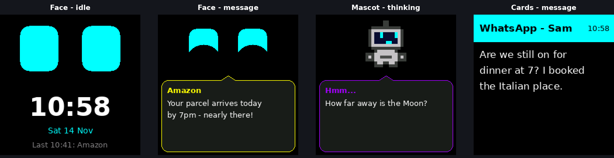

# SmallTV Assistant

Custom firmware that turns the GeekMagic **SmallTV‑Ultra** (the £6 ESP8266 "smart weather clock" cube) into a little desk assistant that shows push notifications.



- **Three switchable styles:** an animated robot **face**, a pixel‑art **mascot** ("Bit") and minimal **cards**. Switch them from the web page, with a command, or from a script.
- **Phone notifications** reach the cube through [ntfy](https://ntfy.sh), so they work from anywhere, not only on your home Wi‑Fi.
- **Claude** (optional) rewrites notifications into short, friendly lines, chooses a mood and can filter out spam. You can also ask it questions from your phone and read the answer on the cube.
- A clock and date sit under the character when it's idle. It gets sleepy and dims at night. The eye colour can be changed, and there's a settings page at `http://smalltv-assistant.local`.

```
Phone ──(MacroDroid)──► ntfy  <topic>-in ──► Claude bridge ──► ntfy <topic> ──► cube
You   ──(ntfy app)────► ntfy  <topic>-ask ─┘                     ▲
Scripts / Home Assistant ───────────────────────────────────────┘   (or POST http://cube/notify)
```

> **Status:** written for the hardware documented by the community (ESP‑12F, ST7789 240×240, DC=GPIO0, RST=GPIO2, backlight=GPIO5 active‑low). It has not been run on a physical unit yet. If the first build or boot shows a problem, see *Troubleshooting*.

---

## 1. Build the firmware (.bin)

**Easiest: GitHub builds it for you**

1. Create a new GitHub repository and upload this whole folder, including the hidden `.github` folder.
2. Open the **Actions** tab. The *Build firmware* workflow runs automatically and takes about 3 minutes.
3. Open **Releases** and download `smalltv-assistant.bin`. You can do this on your phone.

**Or build it on your computer:** install [PlatformIO](https://platformio.org/install) and run `pio run`. The file ends up at `.pio/build/smalltv/firmware.bin`.

## 2. Before flashing: know your way back

**Clone "Smart weather clock Pro" / SDPro firmware (not GeekMagic):** keep the seller's `SDPro_V1.0.6_….bin` from their Google Drive. That is your way back. This firmware uses the same flash layout as SDPro (1 MB app, 3 MB LittleFS) and never formats the filesystem, so the stock web pages, photos and GIFs stay on the cube. Uploading the SDPro `.bin` at `http://<ip>/update` should therefore give you the original clock back.

**Real GeekMagic SmallTV‑Ultra:** GeekMagic publishes the official binaries at <https://github.com/GeekMagicClock/smalltv-ultra>. Some people report that, after a reflash, the stock firmware asks for an activation code tied to the cube's MAC address.

Either way, if you have a USB‑serial adapter, a full backup is the safest move: `esptool.py read_flash 0 0x400000 backup.bin`.

## 3. Flash over Wi‑Fi

1. With the stock firmware running, open the IP address shown on the cube in your phone's browser.
2. Find the firmware update section, choose `smalltv-assistant.bin` and upload it. The cube reboots. On the SDPro clone, the upload button is in the settings and posts to `/update_ota`. On GeekMagic it's on the Update page.
3. The cube shows **"Wi‑Fi setup: join SmallTV-Assistant"**. Connect your phone to that network, and a setup page opens (if it doesn't, go to `192.168.4.1`). Pick your home Wi‑Fi and enter the password.
4. The cube shows **Ready!** with its IP address. From now on you can update firmware at `http://<ip>/update`, so there's no need to go back to the stock firmware.

## 4. First‑time setup

Open `http://smalltv-assistant.local`, or the IP address if `.local` doesn't work on your phone.

1. Press **Colour test**. If red and blue are swapped, untick **BGR colour order**. If the colours look like a photo negative, toggle **Invert panel**. Then press **Save**.
2. Tap **Face**, **Mascot** or **Cards** to choose a style.
3. Under **Notifications**, enter a **topic**. Make it long and random, such as `alan-cube-7f3k9q2x`, because anyone who knows a public ntfy topic can post to it. Press **Save**. The page will say *Connected to ntfy*.
4. Send yourself a test message with **Send a test message**.

## 5. Phone notifications (Android)

You need [MacroDroid](https://www.macrodroid.com/) (free), or Tasker if you prefer.

Create a macro:

- **Trigger:** *Notification Received*. Choose the apps you care about, such as Messages, WhatsApp, Gmail and your delivery apps. Pick specific apps; "All apps" gets noisy.
- **Action:** *HTTP Request*
  - Method **POST**
  - URL: `https://ntfy.sh/<your-topic>-in` to go through Claude, or `https://ntfy.sh/<your-topic>` to go straight to the cube with no AI.
  - Body: MacroDroid's *magic text* for the notification text. Add a header `Title`, also set with magic text, for the notification title or app name.
  - Optional header `Tags: happy`, using any mood listed below, to set the mood yourself.

Only send apps you're comfortable relaying through a public ntfy server. You can self‑host ntfy, and the cube supports an access token.

## 6. The Claude assistant (optional)

`bridge/claude_bridge.py` runs on anything that's always on: a Raspberry Pi, a home server, or your PC while it's on. It uses only the Python standard library.

```bash
export ANTHROPIC_API_KEY=sk-ant-...        # from console.anthropic.com
python3 bridge/claude_bridge.py --topic alan-cube-7f3k9q2x            # rewrite notifications
python3 bridge/claude_bridge.py --topic alan-cube-7f3k9q2x --filter   # ...and drop spam/promos
```

**Running it on a Raspberry Pi (e.g. a Pi Zero W, even one already running Pi‑hole):** copy the `bridge` folder to the Pi and run `bash bridge/install_pi.sh`. It asks for your topic and API key, then installs a service that starts at boot and restarts itself if it crashes. Watch it with `journalctl -u smalltv-bridge -f`.

- **Ask it things from your phone:** in the ntfy app, subscribe to `<topic>-ask` and type a question. The cube shows a "thinking" face, then the answer.
- **One‑off from a terminal:** `python3 bridge/claude_bridge.py --topic ... ask "What's 17% of 240?"`
- **No Claude, just a message:** `python3 bridge/claude_bridge.py --topic ... say "Tea's ready" --mood happy`
- Uses `claude-haiku-5-5` by default. Change it with `--model` or the `CLAUDE_MODEL` environment variable.
- Notification text is sent to Anthropic's API for rewriting. If Claude can't be reached, the original notification is forwarded unchanged.

## 7. Sending messages from anything

```bash
# via ntfy (from anywhere)
curl -H "Title: Washing machine" -H "Tags: happy" -d "Your laundry is done" ntfy.sh/<topic>

# directly on your home network
curl -X POST http://smalltv-assistant.local/notify \
     -H "Content-Type: application/json" \
     -d '{"title":"Build","message":"Tests passed","mood":"happy"}'

# quick GET (handy for Home Assistant / MacroDroid)
http://smalltv-assistant.local/notify?title=Door&message=Someone%20is%20at%20the%20door&mood=surprised
```

**Moods:** `neutral` `happy` `sad` `surprised` `thinking` `sleepy` `love` `angry`. Some ntfy emoji tags also work: `tada`/`white_check_mark` → happy, `warning`/`rotating_light` → surprised, `heart` → love, `x` → sad. Priority‑5 ntfy messages default to *surprised*.

**Commands** (send these as the message text):

| Command | Effect |
|---|---|
| `!style face` / `mascot` / `cards` / `next` | switch style |
| `!brightness 40` | set brightness % |
| `!clear` | dismiss everything on screen |

Other endpoints: `GET /api/state`, `POST /api/config` (JSON), `/api/style?s=next`, `/api/dismiss`, `/api/test`, `/update`.

## 8. Troubleshooting

- **Blank or garbled screen after flashing:** the display pins or SPI mode don't match your board revision. Upload different firmware through `http://<ip>/update` if the cube is on Wi‑Fi (the IP will be in your router's client list). If it isn't, you'll need to flash over serial: open the case (2 screws underneath), wire a 3.3 V USB‑serial adapter to the pads, and hold GPIO0 to GND while powering on.
- **Wrong colours:** use the Colour test and the two checkboxes.
- **"Not connected to ntfy":** check the topic, and that the server is `ntfy.sh` on port 80. The cube uses plain HTTP because the ESP8266 doesn't have the memory for HTTPS. Self‑hosted servers work too.
- **Clock wrong:** set the time zone. It takes POSIX format; UK is `GMT0BST,M3.5.0/1,M10.5.0`.
- **Low memory message:** animations are turned off, but the Cards style still works.

## Project layout

```
platformio.ini        board + display configuration
src/main.cpp          Wi-Fi, web server, ntfy, notification queue, screens
src/face.h            animated robot eyes
src/mascot.h          pixel-art robot "Bit"
src/textutil.h        UTF-8 -> ASCII, word wrap
src/webpage.h         settings page
bridge/               Claude bridge script
```
